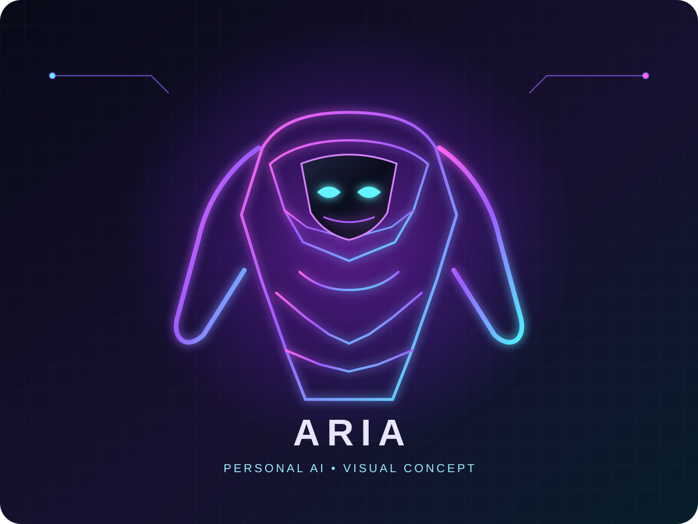

# ARIA 🤖

Personal AI assistant project built step by step with Python, Ollama, Kotlin and Jetpack Compose.

## ARIA visual concept

This is a concept illustration for a possible future embodied ARIA interface, not a claim that a humanoid robot has been built. See [MIRA visual research and ARIA design direction](docs/mira-visual-research.md) for related open-source projects and the planned, safety-conscious adaptation.

## Current milestone

ARIA now has a two-device local-first prototype:

    Android phone
          │
          │ authenticated LAN connection
          ▼
    Python ARIA server
          │
          ▼
    Ollama + Qwen3 1.7B
          │
          ▼
    Persian AI response

The Android companion uses Jetpack Compose and Android Text-to-Speech. The laptop runs the local ARIA server and local LLM.

## Project goals

- Persian conversational assistant
- creator/owner identity
- trusted-device authentication
- local-first operation
- structured memory
- explicit permission before sensitive actions
- safe tool execution
- web research when online
- threat-awareness and security monitoring for the owner's devices
- future server and multi-device support

## Learning path

1. Python
2. Ollama and local LLMs
3. LLM APIs
4. Kotlin and Jetpack Compose
5. Android networking
6. authentication and trusted devices
7. memory
8. permission engine
9. tool calling
10. RAG
11. AI agents
12. Machine Learning

## Repository map

    aria.py
    server/
        aria_server.py
        requirements.txt
    android/
        settings.gradle.kts
        build.gradle.kts
        app/
    docs/
        architecture.md
        protection.md
        android-setup.md
        mira-visual-research.md
        assets/
            aria-humanoid-concept.svg
    learning/
        01-ollama.md
        02-architecture.md
        03-two-device.md

## Portfolio note

This repository is a learning and engineering portfolio. Each milestone documents what was actually built and which technologies were practiced. The project is intentionally developed incrementally rather than presenting unfinished capabilities as production-ready.

## Security principle

ARIA is designed to assist its owner, not to bypass operating-system security or silently perform sensitive actions. Destructive, security-sensitive, financial, deployment and external communication actions will require explicit owner authorization.

## Current milestone documentation

See docs/android-setup.md for the Android + laptop setup and docs/protection.md for the threat-awareness architecture.

## Latest milestone

The ARIA core now includes persistent memory, deterministic permission classification, online/local runtime selection, Android cloud-first fallback architecture, and automated Python tests.

The next phase is the safe tool registry and owner approval workflow.

## UI and voice milestone

The Android client and laptop web dashboard now share the ARIA visual language: animated central eye, live connectivity state, chat panel, Persian speech input and Persian text-to-speech output.

Voice recognition is implemented as press-to-talk rather than an always-listening loop. Android's SpeechRecognizer documentation notes that the platform recognizer may stream audio to remote services and is not intended for continuous recognition, so continuous listening will be added only with an explicit local/permission-aware design.

Compose's built-in animation APIs power the eye/HUD effects, keeping the interface lightweight and testable.
