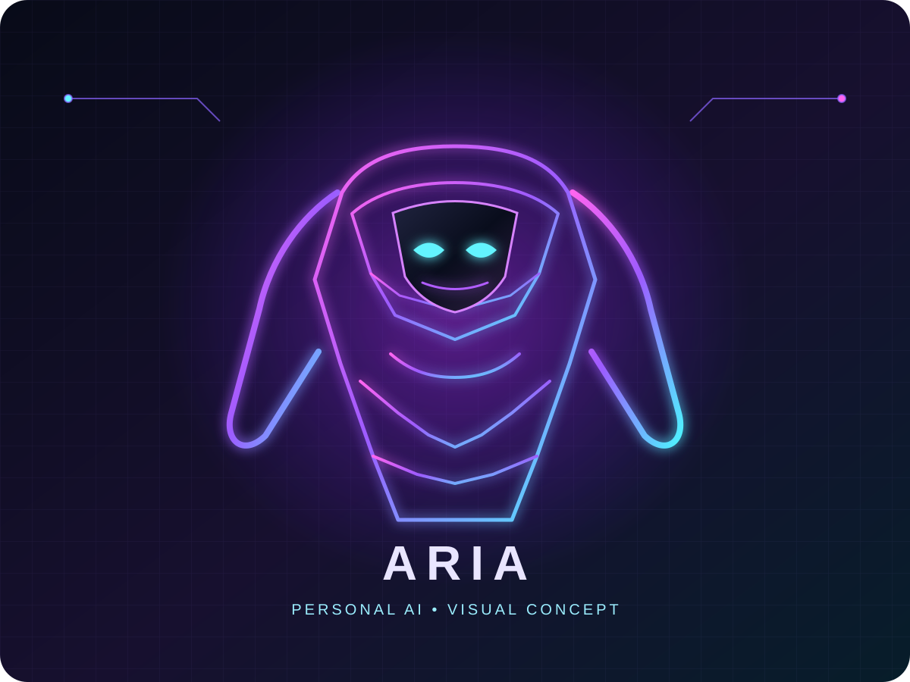

# ARIA 🤖

Personal AI assistant project built step by step with Python, Ollama, Kotlin and Jetpack Compose.

## ARIA visual concept

This is a concept illustration for a possible future embodied ARIA interface, not a claim that a humanoid robot has been built. See [MIRA visual research and ARIA design direction](docs/mira-visual-research.md) for related open-source projects and the planned, safety-conscious adaptation.

## Current milestone

ARIA now has a two-device local-first prototype:

    Android phone
          │
          │ authenticated LAN connection
          ▼
    Python ARIA server
          │
          ▼
    Ollama + Qwen3 1.7B
          │
          ▼
    Persian AI response

The Android companion uses Jetpack Compose and Android Text-to-Speech. The laptop runs the local ARIA server and local LLM.

## Project goals

- Persian conversational assistant
- creator/owner identity
- trusted-device authentication
- local-first operation
- structured memory
- explicit permission before sensitive actions
- safe tool execution
- web research when online
- threat-awareness and security monitoring for the owner's devices
- future server and multi-device support

## Learning path

1. Python
2. Ollama and local LLMs
3. LLM APIs
4. Kotlin and Jetpack Compose
5. Android networking
6. authentication and trusted devices
7. memory
8. permission engine
9. tool calling
10. RAG
11. AI agents
12. Machine Learning

## Repository map

    aria.py
    server/
        aria_server.py
        requirements.txt
    android/
        settings.gradle.kts
        build.gradle.kts
        app/
    docs/
        architecture.md
        protection.md
        android-setup.md
        mira-visual-research.md
        assets/
            aria-humanoid-concept.svg
    learning/
        01-ollama.md
        02-architecture.md
        03-two-device.md

## Portfolio note

This repository is a learning and engineering portfolio. Each milestone documents what was actually built and which technologies were practiced. The project is intentionally developed incrementally rather than presenting unfinished capabilities as production-ready.

## Security principle

ARIA is designed to assist its owner, not to bypass operating-system security or silently perform sensitive actions. Destructive, security-sensitive, financial, deployment and external communication actions will require explicit owner authorization.

## Current milestone documentation

See docs/android-setup.md for the Android + laptop setup and docs/protection.md for the threat-awareness architecture.

## Iranian websites MCP integrations

See [docs/iranian-mcp-integration.md](docs/iranian-mcp-integration.md) for the selected Iranian website MCP catalog, backend architecture, security rules and rollout plan. MCP tools are backend integrations, not LLM inference or image/video generation providers.

## Molab GPU lab

A personal, interactive GPU notebook for testing Qwen3 models is available at [notebooks/aria_molab_gpu_lab.py](notebooks/aria_molab_gpu_lab.py). Read [docs/molab-gpu-lab.md](docs/molab-gpu-lab.md) before use. Molab is not an ARIA backend or public inference API; its acceptable use rules prohibit exposing its compute to external traffic.

## Paperclip agent orchestration

See [docs/paperclip-integration-fa.md](docs/paperclip-integration-fa.md) for the Persian integration plan. Paperclip is an optional, separate control plane for coordinating AI agents; it is not an LLM provider and is not embedded in the Android APK. Deployment and a real agent run are still pending.

## Iran-compatible cloud deployment

The current default cloud-provider integration is 1xAi, an OpenAI-compatible Iranian API gateway. It supports one server-side key for a curated choice of models from GPT, Claude, Gemini, DeepSeek, Grok, Kimi, GLM, Qwen, MiniMax and Hunyuan. See [docs/1xai-integration-fa.md](docs/1xai-integration-fa.md) for account setup, key handling, the Weblines deployment configuration, model allowlist, image generation, separate video-provider requirements and paid-launch gates. Keep all API keys in hosting secrets, never in the APK or repository. The app includes a model picker; a real API key and successful server deployment are still required.

## Latest milestone

The ARIA core now includes persistent memory, deterministic permission classification, online/local runtime selection, Android cloud-first fallback architecture, and automated Python tests.

The next phase is the safe tool registry and owner approval workflow.

## UI and voice milestone

The Android client now has a warm, Claude-inspired light chat layout, Persian speech input and Persian text-to-speech output. The latest beta also includes a server-backed model picker for the configured allowlist.

Voice recognition is implemented as press-to-talk rather than an always-listening loop. Android's SpeechRecognizer documentation notes that the platform recognizer may stream audio to remote services and is not intended for continuous recognition, so continuous listening will be added only with an explicit local/permission-aware design.

Compose's built-in animation APIs power the eye/HUD effects, keeping the interface lightweight and testable.

## Public app and subscription roadmap

The planned public release, free-trial/subscription tiers, verified payment handling, owner user-management console, ideas menu, update notices, Persian voice, and resilient local/domestic/cloud modes are documented in [docs/public-product-roadmap.md](docs/public-product-roadmap.md). These are roadmap items, not claims that billing or public production service is already live. The Android APK build must succeed and be tested before sharing a public installer.

## VPN, creative studio, and updates roadmap

The proposed separate VPN menu, official Shir o Khorshid/MahsaNG links, image/video generation, owner-free access, and app update notices are documented in [docs/vpn-creative-updates-roadmap.md](docs/vpn-creative-updates-roadmap.md). These are roadmap items; direct VPN tunneling, creative generation, owner subscriptions, and push updates are not claimed as implemented.

## Iran launch checklist

See [docs/launch-in-iran-fa.md](docs/launch-in-iran-fa.md) for the current 1xAi chat/image + AvalAI video architecture, VPS checklist, secrets, deployment, health checks and revenue safeguards.
